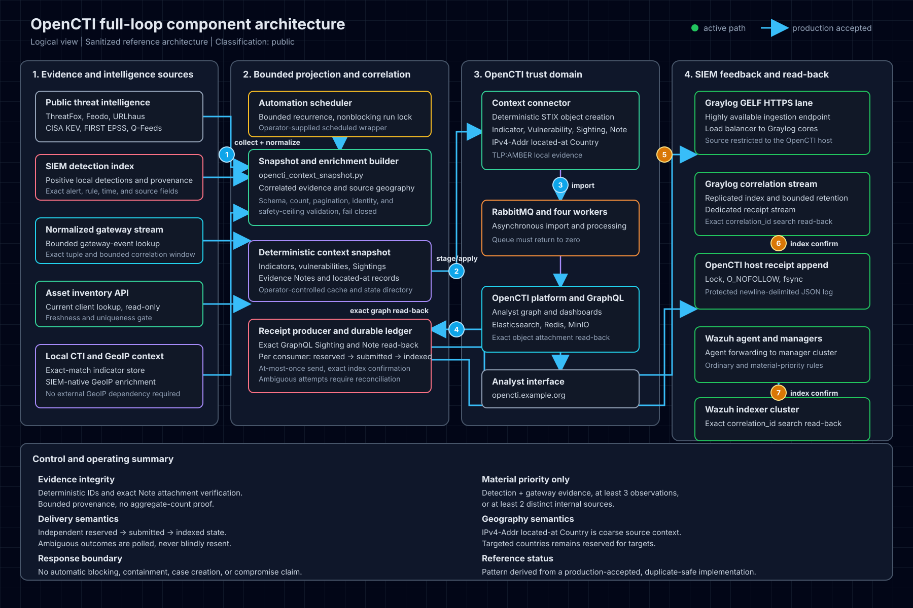

# OpenCTI full feedback loop

This reference architecture closes the loop from SIEM evidence to OpenCTI context and back to the SIEM. It is derived from a production-accepted implementation, but all environment-specific addresses, host identifiers, schedules, paths, credentials, and evidence have been removed.

PNG fallback: [OpenCTI full-loop component architecture](architecture/opencti-full-loop.png)

## Objective

The loop turns local detections and observations into threat-intelligence graph context, verifies that OpenCTI imported the exact expected evidence, and returns a correlation receipt to independent Graylog and Wazuh paths. A successful API submission is not treated as proof of import or delivery.

The control flow is:

1. Collect bounded threat-intelligence, SIEM detection, gateway, asset, and GeoIP context.
2. Normalize the inputs and build a deterministic context snapshot.
3. Project Indicators, Vulnerabilities, Sightings, Notes, and relationships into STIX.
4. Submit the bundle to OpenCTI and wait for asynchronous processing to settle.
5. Read the exact Sighting and complete expected Note set back through GraphQL.
6. Create a stable correlation receipt only after exact graph verification.
7. Deliver the receipt independently to Graylog and Wazuh.
8. Search each destination by exact correlation ID and require one indexed record.

## Inputs and trust boundaries

The public threat-intelligence side can include malware indicators, known exploited vulnerabilities, exploit-prediction scores, and other licensed or open feeds. Local context can include:

- positive SIEM detections and their rule provenance;
- normalized gateway observations;
- read-only asset inventory lookups;
- exact-match local indicator context;
- SIEM-native GeoIP enrichment.

Every input is bounded by schema, count, pagination, source identity, freshness, uniqueness, and safety-ceiling checks. A missing required source or failed validation stops the run before projection.

Local evidence should use an appropriate marking, such as TLP:AMBER. Do not publish internal evidence into a shared OpenCTI tenant without an explicit handling decision.

## Deterministic OpenCTI projection

Use deterministic STIX identifiers so repeated projection converges rather than creating duplicate graph objects. Typical objects and relationships are:

- Indicator;
- Vulnerability;
- Software;
- Sighting;
- Note containing canonical evidence;
- Indicator-to-malware relationships;
- IPv4-Addr observables;
- IPv4-Addr `located-at` Country relationships.

Source geography is coarse observation context. Do not model a source address as targeting a country. Reserve `targets` relationships and targeted-country reporting for defensible intelligence assertions.

## Exact graph verification

OpenCTI imports asynchronously. The producer must wait for work and queue processing to settle, then query OpenCTI for the expected graph state. For every eligible correlation, verify:

- the exact expected Sighting exists;
- the complete expected evidence Note set is attached;
- every Note contains the expected canonical evidence;
- the Sighting maps unambiguously to one local correlation;
- no expected Note is missing, malformed, reused, or ambiguous.

Hash canonical JSON evidence with SHA-256 and use the digest as the evidence identity. Aggregate counts alone are not proof because stale or unrelated Notes can satisfy a count.

## Correlation receipt contract

A receipt should contain only the fields needed to prove context and support investigation:

- stable correlation ID;
- OpenCTI Sighting identifiers;
- imported evidence Note identifiers;
- indicator type, value, source, and confidence;
- local alert and rule provenance;
- observation count and time range;
- evidence classes and count;
- coarse source geography, when available;
- material-priority state and reasons;
- analyst URL;
- correlation latency.

Exclude delivery timestamps from the correlation ID so retries do not change identity.

## Independent SIEM delivery

Graylog and Wazuh are separate consumers with separate acknowledgement and state. One consumer succeeding must not advance the other.

For Graylog:

- send the receipt over verified GELF HTTPS;
- restrict the listener to the expected source where practical;
- route receipts to a dedicated stream and bounded-retention index;
- search the complete retention horizon by exact correlation ID;
- require exactly one indexed document.

For Wazuh:

- append newline-delimited JSON through a protected local log;
- reject symlinks with `O_NOFOLLOW`;
- use exclusive locking and `fsync`;
- let the local agent forward the event;
- search the Wazuh index by exact correlation ID;
- require exactly one indexed alert.

Use separate ordinary and material-priority rules. Material priority should require added cross-source evidence, for example detection plus gateway evidence, at least three observations, or at least two distinct internal sources. Original severity or indicator confidence alone should not elevate the receipt.

## Durable at-most-once state

Track each consumer independently through:

`reserved -> submitted -> indexed`

Persist `reserved` before contacting a consumer. Use an exclusive nonblocking lock, atomic file replacement, restrictive file mode, file `fsync`, and parent-directory `fsync`.

Recovery rules:

- If exactly one destination record already exists, recover state without resending.
- If more than one exists, fail closed and investigate the duplicate.
- If an older attempt is ambiguous, poll the destination but do not blindly resend.
- Preserve the ledger during backup, restore, and rebuild.

This is at-most-once submission with exact destination reconciliation. It is not distributed exactly-once delivery.

## Operations and acceptance

A healthy scheduled run requires:

- the bounded snapshot to pass every validation gate;
- OpenCTI work to complete successfully;
- message queues to return to zero ready and zero unacknowledged;
- exact Sighting and Note read-back to pass;
- every eligible receipt consumer to reach `indexed`;
- exact destination cardinality of one in Graylog and Wazuh;
- a repeated run over unchanged input to leave ledger and index cardinality unchanged;
- authenticated browser validation of the analyst dashboards.

Monitor service health, connector freshness, failed work, queue depth, capacity ceilings, receipt state, destination duplicates, and dashboard rendering.

## Rebuild and disaster recovery

Restore the OpenCTI stack, connector and receipt modules, protected runtime configuration, current threat-intelligence data, SIEM inputs and streams, source restrictions, Wazuh rules, scheduler, and durable receipt ledger.

Before restoring recurrence:

1. Run a bounded projection.
2. Require exact graph read-back.
3. Require settled queues.
4. Require one indexed receipt per destination.
5. Require a healthy operational report.
6. Complete authenticated dashboard acceptance.

If the ledger is unavailable, reconcile both destination indexes by exact correlation ID before any replay.

## Rollback

1. Pause and read back the scheduler state.
2. Preserve the ledger, snapshot, OpenCTI work history, and indexed evidence.
3. Restore the prior compatible runtime, connector, and snapshot implementation.
4. Recreate only the connector components that require replacement.
5. Require healthy services and settled queues.
6. Restore SIEM configuration through recorded transactional rollback procedures.
7. Do not delete graph objects, receipts, indexes, or recovery artifacts without separate approval.

## Security boundary

The loop confirms evidence import and SIEM feedback. It does not prove compromise, successful network sessions, attribution, attacker nationality, or targeting. It performs no automatic blocking, containment, case creation, incident declaration, or analyst disposition.

The diagram and this document describe the integration contract. They do not include a turnkey OpenCTI deployment or environment-specific connector configuration.